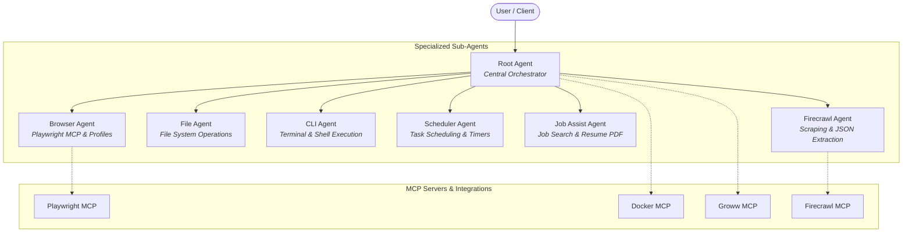

# Multi-Agent Orchestration Framework

A modular, multi-agent AI system built on top of **Google ADK (Agent Development Kit)**, **LiteLLM**, **MCP (Model Context Protocol)** servers, and **Rust / PyO3** native extensions.

The architecture employs a central orchestrator (`root_agent`) that coordinates specialized sub-agents to handle complex browser automation, file system operations, terminal command execution, job assistance & resume generation, scheduling, and high-speed web scraping.

---

## 🏛️ Architecture Overview



---

## 🤖 Agents & Capabilities

| Agent | Description | Key Tools & MCP Integrations |
| :--- | :--- | :--- |
| **`root_agent`** | Central orchestrator coordinating all tasks, short/long-term memory, time checks, and high-level decisions. | `getCurrentTime`, `DOCS_TOOLS`, Docker / Groww MCP |
| **`browser_agent`** | Autonomous web browsing agent with session and browser profile management. | `Playwright MCP`, `BROWSER_PROFILE_TOOLS` |
| **`file_agent`** | Local filesystem management (create, read, update, append, list, delete). | `FILE_TOOLS` |
| **`cli_agent`** | Terminal and command-line execution agent. | `CLI_TOOLS` |
| **`scheduler_agent`**| Task scheduling, timer registration, cron jobs, and background schedule management. | `SCHEDULE_TOOLS` |
| **`job_assist_agent`**| Job hunting assistant with automated professional PDF resume generation. | `RESUME_TOOLS` (`generate_resume_pdf`) |
| **`firecrawl_agent`**| Fast web scraping, domain sitemap crawling, web search, and structured schema JSON extraction. | `Firecrawl MCP` |
| **`job_scout_agent`** | Browses job sites with a saved browser profile and saves ~100 real postings. | `Playwright MCP`, `JOB_SCOUT_TOOLS` |
| **`job_matcher_agent`** | Scores each job on skills, experience, role fit, location, pay, growth, company and explains why. | `JOB_MATCHER_TOOLS` |
| **`resume_tailor_agent`** | Writes a truthful, job-specific resume as ONE self-contained HTML+CSS file (`modern` / `classic`). | `RESUME_TAILOR_TOOLS` |

### 🎯 Job Hunt pipeline

`scout -> match -> tailor`, driven by `root_agent` or step by step from the **Job Hunt** tab (dock menu -> Job Hunt).
Data lives in `data/jobhunt/` (git-ignored; override with `JOBHUNT_DIR`). The tab shows pipeline progress, ranked jobs with
score breakdowns, and a print-ready resume preview (Print / Save PDF). Optional per-agent model env vars:
`JOB_SCOUT_AGENT`, `JOB_MATCHER_AGENT`, `RESUME_TAILOR_AGENT` (each with `_BASE_URL` / `_KEY`), falling back to the browser / root models.
"Preview with sample data" loads clearly labelled sample jobs so you can see the UI without running agents.

---

## 🔌 MCP (Model Context Protocol) Servers

- **Playwright MCP**: Headless or interactive Chromium browser automation with persistent session profiles.
- **Firecrawl MCP**: Web crawling, scraping, and LLM-driven structured extraction.
- **Docker MCP**: Management and execution within Docker containers.
- **Groww MCP**: Financial and investment data toolset integration.

---

## 🛠️ Tech Stack

- **Core Framework**: [Google ADK](https://github.com/google/agent-development-kit) (`google-adk[extensions]`)
- **LLM Routing**: [LiteLLM](https://github.com/BerriAI/litellm) (OpenAI-compatible endpoints, NVIDIA NIM, etc.)
- **Performance Layer**: Rust extensions via [PyO3](https://pyo3.rs/) and [Maturin](https://www.maturin.rs/)
- **Document & PDF Processing**: ReportLab & PyPDF2 / pdfplumber for resume generation and analysis

---

## 🚀 Getting Started

### 1. Prerequisites

- Python 3.10+ (or Python 3.8+)
- [Rust & Cargo](https://rustup.rs/) (for building PyO3 native bindings)
- [Node.js & npx](https://nodejs.org/) (for Playwright MCP and other server components)

### 2. Installation

Clone the repository and set up a virtual environment:

```bash
# Clone repository
git clone https://github.com/YashRaj9211/agents.git
cd agents

# Create & activate virtual environment
python -m venv .venv
# On Windows:
.venv\Scripts\activate
# On Linux/macOS:
source .venv/bin/activate

# Install Python dependencies
pip install -r requirements.txt

# Build and install Rust bindings in development mode
(cd native && maturin develop)
```

### 3. Environment Configuration

Copy or create a `.env` file in the project root:

```env
# Agent Model & Provider Configuration
ROOT_AGENT="nvidia/nemotron-3-super-120b-a12b"
ROOT_AGENT_BASE_URL="https://integrate.api.nvidia.com/v1"
ROOT_AGENT_KEY="your-api-key"

BROWSER_AGENT="nvidia/nemotron-3-super-120b-a12b"
BROWSER_AGENT_BASE_URL="https://integrate.api.nvidia.com/v1"
BROWSER_AGENT_KEY="your-api-key"

# Firecrawl API Key (optional for Firecrawl agent)
FIRECRAWL_API_KEY="your-firecrawl-key"

# Chroma Vector DB (Optional for vector storage)
CHROMA_HOST="api.trychroma.com"
CHROMA_API_KEY="your-chroma-key"
CHROMA_TENANT="your-tenant-id"
CHROMA_DATABASE="agents"

# Browser Mode
BROWSER_MODE="True"
```

---

## 📂 Project Structure

```text
agents/
├── backend/                 # Python backend (add backend/ to PYTHONPATH / run from it)
│   ├── server.py            # Uvicorn entrypoint
│   ├── app/                 # FastAPI: routes, controllers, services, schemas, core
│   ├── adk_agents/          # Agent implementations (root, browser, file, cli, scheduler,
│   │                        #   job_assist, firecrawl, portfolio, a2ui)
│   ├── mcp_servers/         # MCP toolsets (playwright, firecrawl, docker, groww)
│   ├── tools/               # Custom tool collections (browser, cli, file, resume, ...)
│   ├── skills/              # Agent skills
│   ├── db/                  # SQLAlchemy models, connection, repository
│   ├── config/              # Service configs (chromadb)
│   ├── scripts/             # One-off scripts (parse_resume.py)
│   └── tests/
├── native/                  # Rust PyO3 module (Cargo.toml, pyproject.toml, src/lib.rs)
├── frontend/                # React/Vite UI
├── infra/
│   ├── docker/              # Dockerfile, Dockerfile.garage-init
│   ├── garage/              # garage.toml, init-garage.sh
│   └── db/                  # schema.sql
├── docs/                    # database_schema.md
├── data/                    # gitignored: SQLite DBs, browser_profiles, personal files
├── docker-compose.yml
├── requirements.txt
└── README.md
```

---

## 💻 Usage Example

You can run and interact with the agents using the Google ADK runner:

```python
from adk_agents.root_agent.agent import root_agent

# Run the root agent with an instruction
response = root_agent.run("Find 3 senior AI engineer roles in Berlin and generate a customized PDF resume for me.")
print(response)
```

---

## 🧑‍💻 Running the Web App Locally

The FastAPI backend and the React UI (`frontend`) run separately.

### 1. Backend (FastAPI)

```bash
# from the repository root
.venv/Scripts/python.exe -m uvicorn server:app --host 127.0.0.1 --port 8000
```

`backend/server.py` also honours `BACKEND_HOST`, `BACKEND_PORT` and `BACKEND_RELOAD`, so a
port clash can be resolved without editing code:

```bash
BACKEND_PORT=8021 python backend/server.py
```

### 2. Frontend (Vite + React)

```bash
cd frontend
npm install
npm run dev
```

The dev server reverse-proxies `/api` to the backend, so the browser stays on a
single origin and the SSE chat stream needs no CORS handling. The proxy target
defaults to `http://127.0.0.1:8000`; point it somewhere else when the backend
runs on a different port:

```bash
VITE_DEV_BACKEND_URL=http://127.0.0.1:8021 npm run dev
```

`api.ts` builds every request against a relative `/api` prefix unless
`VITE_BACKEND_URL` is explicitly set (use that for a cross-origin/deployed API).

### 3. Verifying the wiring

With the backend up and the dev server proxying to it:

```bash
python backend/tools/dev/check_frontend_backend.py        # streams SSE through the proxy
python tests/test_api_suite.py                     # full REST suite
python tests/test_ui_contract.py                   # API shapes the UI depends on
```

---

## 🧵 Parallel Runs, Agent Collaboration & Stopping a Run

Agent execution is owned by `backend/app/services/run_manager.py`, not by the HTTP
request that started it. A run is a background task with a bounded event buffer
and any number of viewers, which is what makes the following possible.

### What you can do

| Capability | How |
| :--- | :--- |
| Run many agents at once | Each session executes independently; runs are visible in the **Running agents** panel |
| Move between running sessions | Switching conversations (or reloading the page) re-attaches to the run; the run is never interrupted |
| Stop one run | **Stop agent** in the header, or **Stop** on any row of the Running agents panel |
| Have agents talk to each other | `send_message_to_agent`, `list_agent_sessions` tools |
| Fan work out and collect it | `spawn_agents` starts N parallel runs, `await_agents` collects their answers, `cancel_agent_run` stops them |

### Run management API

| Method | Path | Purpose |
| :--- | :--- | :--- |
| `GET` | `/api/runs?status=running\|all\|<status>&session_id=` | Fleet listing with `active_count` / `limit` |
| `GET` | `/api/runs/{run_id}` | One run's status, elapsed time and last sequence |
| `GET` | `/api/runs/{run_id}/stream?cursor=N` | SSE `attach` frame, then replay from `N` and live-tail |
| `POST` | `/api/runs/{run_id}/cancel?cascade=true` | Stop a run and, by default, the runs it spawned |
| `POST` | `/api/sessions/{session_id}/cancel` | Stop whichever run that conversation has in flight |
| `GET` | `/api/sessions/{session_id}/messages/pending` | Peer-agent messages queued for a busy session |

`POST /api/chat/stream` keeps its request body and event shape (first frame
`start`, last frame `done`), and now detaches instead of aborting when the client
disconnects. Terminal frames per run are `done` (finished, successfully or not),
`cancelled` (stopped), plus a `run_status` bookkeeping frame.

### Concurrency rules

* One active run per session. A second request gets `409 session_busy` (the
  error payload carries the live `run_id` so the UI can attach to it instead);
  agent tools receive `{"error": "session_busy"}`.
* A global cap of `MAX_CONCURRENT_RUNS` returns `429 capacity_exceeded`, and
  `spawn_agents` reports which tasks it could not start.
* Peer messages are delivered at **turn boundaries**: an idle session starts
  working immediately, a busy one queues the message and drains it when the
  current run finishes. `AGENT_REPLY_HOP_LIMIT` bounds agent-to-agent ping-pong.

### Configuration

| Variable | Default | Meaning |
| :--- | :--- | :--- |
| `MAX_CONCURRENT_RUNS` | `8` | Global cap on simultaneous runs |
| `RUN_EVENT_BUFFER_SIZE` | `2000` | Events retained per run for replay |
| `RUN_CANCEL_TIMEOUT_SECONDS` | `10` | How long to wait for a cancelled run before marking it cancelled anyway |
| `RUN_HEARTBEAT_SECONDS` | `15` | Keep-alive cadence for an idle stream |
| `AGENT_REPLY_HOP_LIMIT` | `6` | Maximum hops in one peer conversation |
| `ADK_SESSION_DB_URL` | `sqlite+aiosqlite:///./data/agents_adk_sessions.db` | ADK's own session/event store |

### Two operational notes

* **`ADK_SESSION_DB_URL` must not be the application database.** ADK's schema
  declares `sessions`, `events`, `app_states` and `user_states` tables, and its
  `sessions` table would collide with this app's own `sessions` table. It
  defaults to a separate SQLite file; point it at a separate Postgres database in
  production if you prefer. Keeping it persistent is what lets a conversation
  remember earlier turns after a backend restart.
* **Restart behaviour.** Runs cannot survive a process restart: startup marks any
  leftover `running` row as `interrupted`, and queued peer messages stay queued
  until that session next runs. Run the backend with `BACKEND_RELOAD=false`
  (`BACKEND_RELOAD=false python backend/server.py`) when you want runs to survive code
  edits, since autoreload restarts the worker.

### Backend test suites

```bash
python tests/test_run_manager.py             # parallel runs, capacity, cancel, replay
python tests/test_server_side_runs.py        # HTTP: detached runs, attach, stop, sync
python tests/test_peer_messaging.py          # agent-to-agent round trips and hop limits
python tests/test_orchestration_tools.py     # spawn_agents / await_agents fan-out
python tests/test_adk_session_persistence.py # memory survives a restart
python tests/test_hitl.py                    # human-in-the-loop questions
```

---

## 📄 License

This project is licensed under the MIT License.
